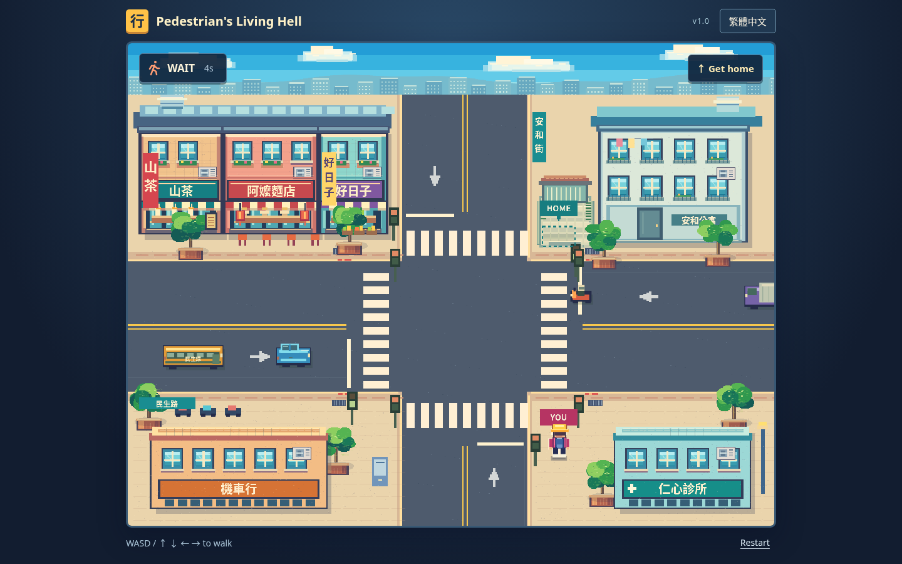

# Pedestrian’s Living Hell · 行人地獄 — v1.0

**[Play v1.0](https://jaychtw.github.io/pedestrian-living-hell/?v=1.0.0)**

One Taiwanese intersection. One pedestrian. Home on the other side. Watch the signals and the drivers: most stop, one might not.

A compact desktop browser game in **English and Traditional Chinese**. Native Canvas 2D, authored pixel art and browser ES modules. No runtime packages, external assets, accounts, backend application service, or production build step.



## Play

- Start with the button or **Enter / Space**.
- You wear a **yellow cap and pink jacket**. Walk with **WASD / arrow keys** to the **HOME / 家** entrance across the eastern crosswalk.
- Read vehicle positions, speed and signals. Red does not lock movement; there are no predictive hazard alerts.
- Collision: **YOU DIED / 歹勢，你鼠翹翹了**. Retry with the button or Enter / Space.
- Arrival: **Home safe. / 平安到家。**
- Switch language at any time. Movement still works after pressing a UI button. Leaving the window or tab pauses play and releases held movement keys.

Supported desktop engines: Chromium and Firefox. Release checks ran on **Chromium 154** and **Firefox ESR 153.5**. Chrome/Edge use the Chromium engine, but their branded applications were not separately installed here. Safari and mobile are not certified; there are no touch controls.

## Develop

Use **Node 24** (`.nvmrc`; development tools require Node >=22.4).

```sh
cd /workspace/pedestrian-living-hell
npm ci --ignore-scripts --cache /workspace/.cache/npm
npm run dev
```

The local static-file server uses port **3000**; `PORT` can override it. No secrets or environment variables are required. GitHub Pages serves the static game without Node.

```sh
npm test                  # 21 logic tests
npm run test:browser      # 13 Chromium checks; server running on 3000
npm run test:firefox      # 7 Firefox checks; server running on 3000
```

Browser tests use system Chromium at `/usr/bin/chromium` and Firefox at a standard installation path (or the prepared cloud cache). Override with `CHROMIUM_PATH` / `FIREFOX_PATH`. `playwright-core` is the sole development dependency; it does not download browsers during `npm ci`. CI installs its pinned browsers explicitly. The Firefox test uses native WebDriver BiDi and no extra npm dependency.

Both test suites write captures into ignored `artifacts/`; reviewed release images are in `docs/screenshots/v1/`. `SCREENSHOT_DIR` can override the capture location. Deterministic scenarios explicitly use `?test`; ordinary play has no test hook. Real keyboard input is also exercised without test mode.

To check the published game with Chromium:

```sh
BASE_URL=https://jaychtw.github.io/pedestrian-living-hell/ SCREENSHOT_DIR=artifacts/live npm run test:browser
# For this cloud's proxy CA, when Chromium's trust store is unavailable:
PLH_USE_PLATFORM_CA=1 BASE_URL=https://jaychtw.github.io/pedestrian-living-hell/ SCREENSHOT_DIR=artifacts/live npm run test:browser
```

The opt-in transport retrieves actual public responses through Playwright’s TLS-verifying Node client using the provided platform CA. Certificate verification remains enabled.

## What v1.0 finishes

- **Coherent visuals:** a 1920 × 1432 render surface over the unchanged 960 × 640 gameplay world and decorative skyline. Fine wall/paving texture, layered foliage, reflective windows, improved directional proportions, a residential façade and a garden entrance at the original home target. No 3D assets or renderer.
- **Consistent roads:** right-hand traffic on both axes, matching arrows/stop lines/signals, and a revised lawful timetable checked for crossing vehicle overlap.
- **Responsive controls:** keyboard movement works after UI focus; browser shortcut modifiers are respected; losing window focus freezes the simulation.
- **Reliable long runs:** traffic bookkeeping is bounded, including ten-cycle regression coverage. Fair feet-based collision, substeps, retry, exact localized outcomes and immediate language switching are retained.
- **Release gates:** CI runs model tests and Chromium/Firefox gameplay checks before publishing the static site.

## Traffic and fairness

The fixed **30-second cycle** is unchanged: horizontal green 0–7; clearance 7–9; vertical green 9–16; clearance 16–18; pedestrian WALK 18–27; clearance 27–30. Ten scheduled vehicles obey signals and one scooter runs red. Already committed vehicles continue clearing; green is a reason to look, not a guarantee.

Traffic uses predefined straight lanes with distinct class speeds, no turning or lane changes, leading-edge stop rules and a following gap. Eastbound traffic uses the southern lane, westbound the northern lane, southbound the western lane, and northbound the eastern lane.

The eastbound runner begins offscreen at **17.8 seconds**, travelling steadily at **135 world pixels/second**. It is visible around 18.43 and reaches the eastern crossing around 23.17: about **4.74 seconds of visible approach**. It has the same appearance as a normal scooter. Watch whether it actually slows for red. Early cautious crossing and waiting until it passes are both tested safe approaches; leaving late without looking causes a reproducible failure. An illegal crossing can succeed in a gap.

The pedestrian’s **12 × 11 feet box** is unchanged. Vehicles use inset collision boxes; art overhangs those conservative boundaries. The player draws above scenery and traffic for visibility. Physics substeps are <=1/120 second and stalled frames are capped at 0.25 second. Buildings are solid; decorative furniture is non-solid.

## Screenshots and validation

- [Opening](docs/screenshots/v1/01-opening-en.png) / [繁體中文 opening](docs/screenshots/v1/03-opening-zh-TW.png)
- [English death](docs/screenshots/v1/06-death-en.png) / [中文死亡畫面](docs/screenshots/v1/07-death-zh-TW.png)
- [Approaching traffic without warnings](docs/screenshots/v1/05-observation-no-warning.png)
- [Home safe](docs/screenshots/v1/04-home-safe-zh-TW.png)
- [720px layout](docs/screenshots/v1/08-playing-720px.png)
- [All 16 directional vehicle appearances](docs/screenshots/v1/09-directional-sprites.png)
- [Firefox gameplay](docs/screenshots/v1/firefox-playing-en.png) / [Firefox death](docs/screenshots/v1/firefox-death-zh-TW.png)

See [validation](docs/VALIDATION.md), [release notes](docs/RELEASE-v1.0.md), and [architecture/art decisions](docs/APPROACH.md). The older P0/P0.1 captures and review are historical baselines.

## Source layout

| File                          | Responsibility                                                                                |
| ----------------------------- | --------------------------------------------------------------------------------------------- |
| `src/model.js`                | World geometry, right-hand lanes, signal clock, fixed timetable, movement/collisions/outcomes |
| `src/render.js`               | High-resolution Canvas 2D, cached scenery, skyline, directional sprites, player layering      |
| `src/main.js`                 | Input/focus/visibility, timing, compact UI, language and result presentation                  |
| `src/i18n.js`                 | Central English / Traditional Chinese resources and storage fallback                          |
| `tests/`                      | Model, Chromium and native Firefox BiDi checks                                                |
| `.github/workflows/pages.yml` | Locked setup, tests, static staging and Pages deployment                                      |

## Release limits

The reference collage was available for this pass. Its layered colour/light relationships and fine material treatment informed the changes. This compact top-down game still uses simpler authored sprites and a symmetric intersection; it does not reach the reference’s richly illustrated city detail. Artistic parity is not claimed.

Human enjoyment, first-glance recognition time and perceived fairness require human playtesting. The fixed scenario is intentionally learnable. There is no audio, touch input, campaign, progression, character selection, extra city, advanced traffic AI or nonvisual spatial-navigation mode. Safari and branded Chrome/Edge were not separately tested. The unavailable original GDD remains a historical specification gap.

v1.0 is the final planned release. No further feature phase is started.
