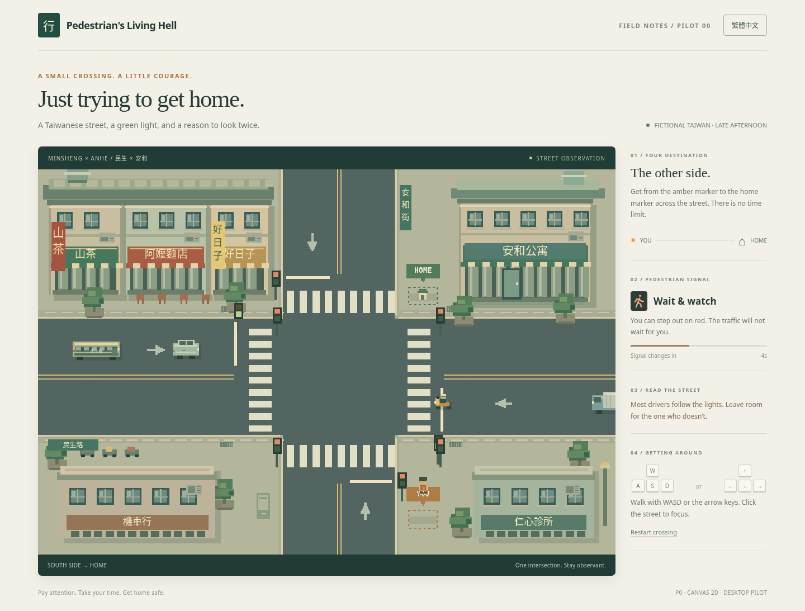

# Pedestrian’s Living Hell · 行人地獄

A playable **Pilot P0** about getting across one Taiwanese intersection. Watch the signals and the drivers: most stop, one scooter sometimes doesn't.

Native HTML5 Canvas 2D, authored pixel sprites, plain ES modules. No runtime packages, backend service, external assets, accounts, or build step. `server.mjs` is a local static-file development server only. Desktop keyboard play; English and Traditional Chinese switch immediately and persist locally when storage is available.

## Run and play

Requires Node.js 20 or newer (validated with 24.19.0).

```sh
cd /workspace/pedestrian-living-hell
npm ci --ignore-scripts --cache /workspace/.cache/npm
npm run dev
```

The server uses port **3000** (`PORT` overrides it). Open the application in a desktop browser using your local development environment. There are no credentials or environment variables to configure.

- Click the start button or press Enter / Space.
- Move with **WASD** or **arrow keys**. Click the street to return keyboard focus after using interface buttons.
- Walk from the amber **YOU / 你** marker on the south sidewalk toward **HOME / 家** at the north end of the eastern crosswalk.
- Observe the pedestrian signal and approaching vehicles. Red does **not** lock movement.
- If the scooter does not slow down, let it pass. There is no time limit.
- A collision ends the attempt without graphic effects; use retry or Enter / Space. Reaching home displays **“Home safe.” / “平安到家。”**
- The language button works on the start, playing, failure and completion screens without resetting the crossing. Hidden tabs pause simulation; lost focus clears held movement keys.

## Validation

```sh
npm test
# In a second terminal, with npm run dev still running:
npm run test:browser
```

The browser suite uses system Chromium at `/usr/bin/chromium`. Set `CHROMIUM_PATH` to another Chromium executable if necessary. `playwright-core` is the sole development dependency; it does not download a browser. On a machine without Chromium, install it using that machine's supported package manager before the optional browser suite. The game itself needs no Chromium installation on the server.

**13 logic tests and 10 Chromium checks passed.** Browser checks cover both languages, persistence, cautious crossing, warned violation, collision, retry, real arrow-key movement on a red light, layout, rendering, and console errors. Approximately 61 animation frames were observed over a one-second headless sample; this is not a hardware benchmark. The browser suite writes current-run screenshots to ignored `artifacts/screenshots/` (`SCREENSHOT_DIR` overrides it); reviewed captures are checked into `docs/screenshots/`. See [validation and limitations](docs/VALIDATION.md).

## Structure

| File | Responsibility |
| --- | --- |
| `src/model.js` | Fixed map collision geometry, signal phases, lane traffic, deterministic schedule, player movement and outcomes |
| `src/render.js` | Canvas-only pixel scenery, façades, directional vehicle art, signals and character |
| `src/i18n.js` | Central English / Traditional Chinese resources and language storage fallback |
| `src/main.js` | Keyboard input, animation timing, interface and live language updates |
| `src/style.css` | Responsive page layout and interface |
| `tests/` | Node logic tests and actual Chromium flows |

## Traffic and fairness

A repeating **30-second scenario** uses one straight lane per direction. Horizontal green: seconds 0–7; clearance: 7–9; vertical green: 9–16; clearance: 16–18; pedestrian WALK: 18–27; clearance: 27–30. Vehicles stop their leading edges before the crossings and maintain a 19-pixel following gap. Already committed vehicles clear the junction.

Four classes have distinct speeds and silhouettes: scooter, sedan, bus and truck. Horizontal sprites show side profiles; vertical sprites show separate front/rear elevations. The entire road is visible, and vehicles spawn outside the walkable world. A fixed timetable keeps retries learnable and tests reproducible.

At **18.8 seconds**, one eastbound scooter approaches from offscreen left at a steady higher speed and ignores red. An amber marker, motion trail and translated street warning accompany it. It reaches the player's crosswalk at about **23.2 seconds**, leaving several seconds of visible approach. The other ten scheduled vehicles obey signals. The scenario repeats once each 30 seconds if the player keeps waiting.

Collision checks use the character's feet (12 × 11 pixels), not their head, and inset vehicle bounds by two pixels. Physics uses substeps no larger than 1/120 second, with frame stalls capped at 0.25 seconds, to avoid large collision jumps. Buildings are solid. Planters and minor street furniture are decorative.

## Visual evidence

Screenshots come from the actual running application, not mockups:

- [English street](docs/screenshots/02-street-en.png)
- [Traditional Chinese start](docs/screenshots/03-start-zh-TW.png)
- [Safe arrival in Traditional Chinese](docs/screenshots/04-home-safe-zh-TW.png)
- [Visible scooter violation](docs/screenshots/05-observable-violation.png)
- [Collision and retry](docs/screenshots/06-failure.png)
- [All 16 vehicle direction/class combinations](docs/screenshots/07-directional-sprites.png)



## Scope and next iteration

The supplied mission and Pilot P0 brief were implemented. The referenced **GDD v0.1 was not attached**, so compliance with that separate document remains unverified. The implementation choices and risks are recorded in [the approach](docs/APPROACH.md).

This pilot mechanically demonstrates observation, a misleading green light, a fair avoidable hazard, and a reachable home. Whether the tension remains engaging for new players needs human playtesting. The repeatable schedule favors clarity over replay variety; a quick illegal crossing can succeed during a traffic gap. Art is small-scale authored pixel art rather than commercial production art. Audio, touch controls, turning traffic, character selection, progression and additional cities are outside P0. Only Chromium was exercised here.

Recommended next work, **in priority order, without implementation**:

1. Watch first-time players and tune warning strength, traffic gaps and crossing speed based on hesitation and failure reasons.
2. Review P0 against the missing GDD and refine front/rear sprites, contrast and destination readability at smaller screen sizes.
3. Validate Firefox, Safari, keyboard focus and reduced-vision usability before considering additional scenarios.

P0 stops here. P1 requires explicit authorization.

## GitHub Pages deployment

`.github/workflows/pages.yml` tests the game and publishes only `index.html` and `src/` on pushes to `main`. No Node server or dependency installation is needed on Pages. Relative asset paths support the project URL `/pedestrian-living-hell/`.

Enable **Settings → Pages → Build and deployment → Source → GitHub Actions** in the repository once. The workflow then deploys each push to `main`; it can also be run manually from Actions. The intended address is `https://jaychtw.github.io/pedestrian-living-hell/`. A successful workflow and live check are required before treating that address as published.
