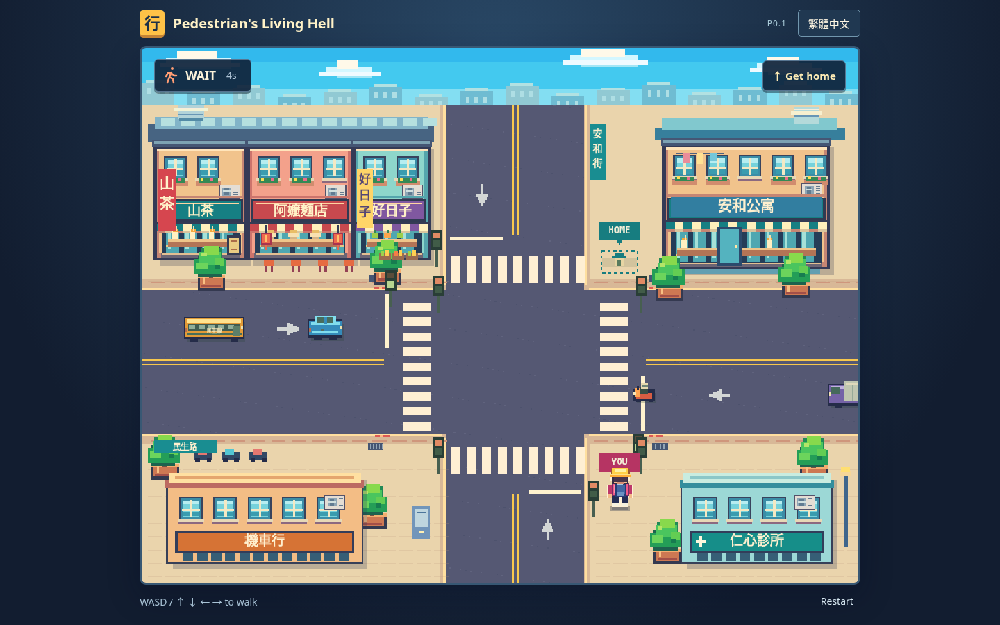

# Pedestrian’s Living Hell · 行人地獄

A playable **P0.1** about getting across one Taiwanese intersection. Most drivers stop; watch whether they actually do. This corrective revision brings brighter pixel art, a visible pedestrian, a compact interface and the requested dramatic death screen. No new gameplay systems or locations.

**[Play on GitHub Pages](https://jaychtw.github.io/pedestrian-living-hell/)**

Native Canvas 2D and browser ES modules. No runtime dependencies, backend service, external assets, credentials or build step. The Node server serves static files locally. English and Traditional Chinese switch immediately and persist when local storage is available.

## Run and play

Requires Node.js 20+ (validated with 24.19.0).

```sh
cd /workspace/pedestrian-living-hell
npm ci --ignore-scripts --cache /workspace/.cache/npm
npm run dev
```

The development server uses port 3000 (`PORT` can override it).

- Start with the button or Enter / Space.
- You wear a **yellow cap and pink jacket**. Use **WASD / arrow keys** to walk to **HOME / 家** across the eastern crosswalk.
- Look at signals, vehicle positions and motion. Red does **not** lock movement. There are no predictive hazard alerts.
- Collision: **YOU DIED / 歹勢，你鼠翹翹了**. Retry with the button or Enter / Space. Arrival: **Home safe. / 平安到家。**
- Switch language at any time. Click the street to restore keyboard focus after using an interface button. Hidden tabs pause simulation; losing window focus clears movement keys.

## Checks

```sh
npm test
# With the development server running:
npm run test:browser
# The same browser suite can test the actual deployment:
BASE_URL=https://jaychtw.github.io/pedestrian-living-hell/ SCREENSHOT_DIR=artifacts/live npm run test:browser
```

**16 logic tests and 12 Chromium checks passed locally.** The browser suite uses system Chromium at `/usr/bin/chromium` (override with `CHROMIUM_PATH`). `playwright-core` is the only development dependency and downloads no browser. Current-run screenshots go to ignored `artifacts/screenshots/` (`SCREENSHOT_DIR` can override it). Reviewed P0.1 captures live in `docs/screenshots/p01/`.

The suite covers bilingual start/death/success/retry, live language switching and persistence, unchanged feet collisions, safe crossing, reproducible violations, removal of predictive text and sprite markers, actual keyboard movement on red, player layering, responsive layouts and browser errors. See [validation](docs/VALIDATION.md) and [revision assessment](docs/P01-REVIEW.md).

## Visual evidence



- [Opening](docs/screenshots/p01/01-opening-en.png) / [繁體中文 opening](docs/screenshots/p01/03-opening-zh-TW.png)
- [YOU DIED](docs/screenshots/p01/06-death-en.png) / [歹勢，你鼠翹翹了](docs/screenshots/p01/07-death-zh-TW.png)
- [Observation without warnings](docs/screenshots/p01/05-observation-no-warning.png)
- [Safe arrival](docs/screenshots/p01/04-home-safe-zh-TW.png)
- [Actual 720-pixel display](docs/screenshots/p01/08-playing-720px.png)
- [16 vehicle appearances](docs/screenshots/p01/09-directional-sprites.png)

The older captures in `docs/screenshots/` are the P0 baseline for comparison.

## Structure

| File            | Purpose                                                                                 |
| --------------- | --------------------------------------------------------------------------------------- |
| `src/model.js`  | World geometry, signal cycle, fixed traffic schedule, movement, collisions and outcomes |
| `src/render.js` | Canvas pixel art, decorative skyline, directional vehicles, character, scene layering   |
| `src/main.js`   | Keyboard input, timing, compact HUD, result presentation, language switching            |
| `src/i18n.js`   | Central English / Traditional Chinese resources and storage fallback                    |
| `src/style.css` | Canvas-first layout, legible interface and localized death typography                   |
| `tests/`        | Node core-logic tests and Chromium functional/visual checks                             |

## Traffic and fair collisions

The unchanged **30-second cycle** uses one straight lane in each direction: horizontal green 0–7; clearance 7–9; vertical green 9–16; clearance 16–18; pedestrian WALK 18–27; clearance 27–30. Ten scheduled vehicles obey lights; one scooter runs red. Vehicles stop their leading edge at the line, maintain a 19-pixel following gap, and clear the junction if already committed.

In P0.1, the violating scooter starts offscreen left at **17.8 seconds**, traveling steadily at **135 world pixels/second**, down from P0’s 165. It becomes visible around 18.43 and reaches the eastern crosswalk around **23.17**: roughly **4.74 seconds of visible approach**. No flags, trails, special paint, or text reveal its future behavior. Watch its failure to slow for the red signal. The fixed schedule is repeatable, not random; waiting for it to pass is a tested safe strategy. An early illegal crossing can also succeed in a traffic gap.

The character art is now about 34 × 52 pixels, with a contrasting outline and backpack. The feet hitbox remains **12 × 11**, and vehicle bounds remain inset by two pixels. The character is composited after vehicles and scenery to prevent occlusion. Physics substeps are at most 1/120 second; frame stalls are capped at 0.25 second. Buildings are solid; decorative furniture and planters remain non-solid.

The render surface is **960 × 716**: the original 960 × 640 gameplay world plus a 76-pixel decorative skyline. The skyline does not move, rescale or expand collision geometry. Rendering remains strictly 2D; no 3D assets or pipeline.

## Scope, limitations and deployment

The two reference images and the original five playtest questions mentioned in the revision brief were not attached. Art was revised from the written direction, and the [review](docs/P01-REVIEW.md) separates composition, sprite quality and Taiwanese identity; reference parity is not claimed. The original GDD v0.1 also remains unavailable. Human playtesting and Firefox/Safari validation remain outstanding. No touch controls, audio, campaign, progression, extra cities or character selection were added.

The existing `.github/workflows/pages.yml` runs logic tests and publishes only `index.html` and `src/` on pushes to `main`. Pages uses **GitHub Actions** as its source. Relative asset URLs support `/pedestrian-living-hell/`; no Node process runs on Pages.

Stop at P0.1. Further gameplay expansion requires explicit authorization.
